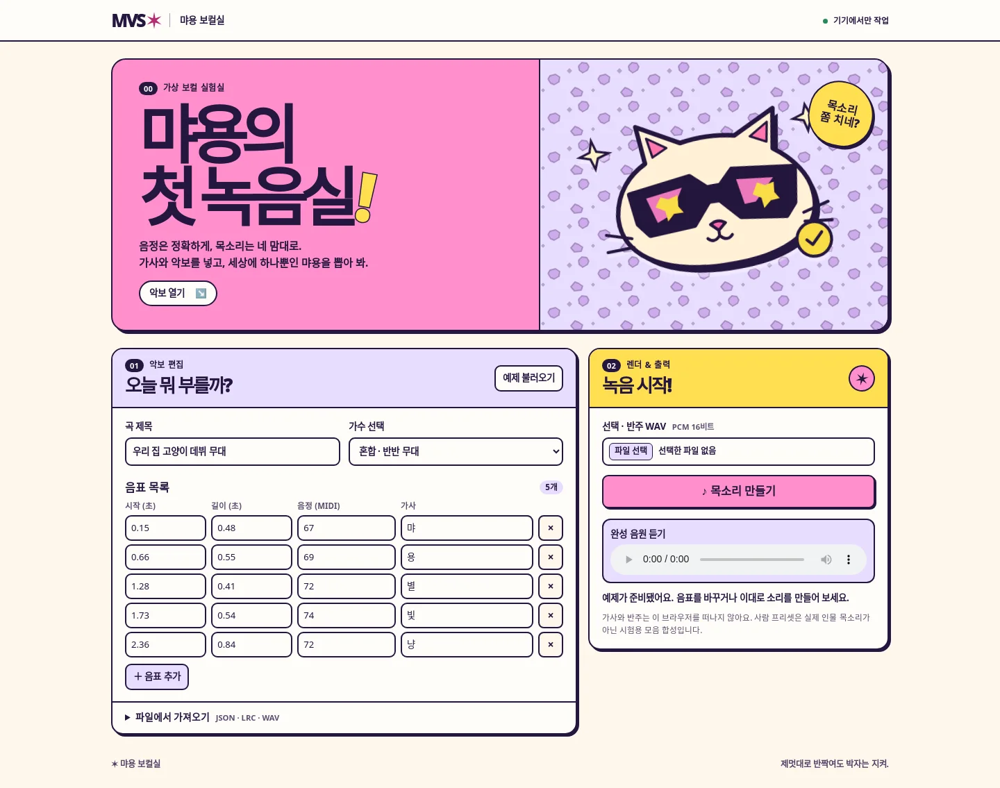

# 먀용 작업실 · Meow Voice System 🐈🎙️

**가사랑 음정을 주세요. 반짝이는 작업실에서 노래는 냥이가 합니다.**

먀용의 자존심은 반짝이보다 타임라인. 쉼표에서는 정말 쉽니다. ㅎㅎ

MVS는 고양이풍·인간풍·혼합 가상 보컬을 실험하는 한국어 프로젝트입니다. 새 작업실은 가사 음절과 음표의 시작·길이를 직접 지정하고, 선택한 음색으로 오프라인 WAV를 만드는 실험판입니다. 고양이 성대의 정밀 물리 재현이나 실제 사람의 발음·목소리 복제는 하지 않습니다. [연구 설계와 구현 상태](docs/mvs/README.md)



[모바일 작업실 화면](docs/mvs/assets/studio-mobile.webp) · [실행과 사용법](docs/mvs/STUDIO.md)

## 성대 실험실과 악보 작업실

| 화면 | 무엇을 하나요? |
| --- | --- |
| **성대 실험실** `/` | 원본 CHIMERA의 2D·3D 성도와 성대 진동을 직접 조작해요. 화면 바깥만 먀용 갸루 테마로 바꿨어요. **원본 테마**를 누르면 기존 외형과 비교할 수 있습니다. |
| **악보 작업실** `/studio/` | 가사와 음정을 입력해 WAV를 만드는 별도 실험판이에요. 성대 실험실의 물리 엔진이 악보 작업실 WAV를 만드는 것은 아닙니다. |

두 화면을 함께 열려면 Rust와 Bun이 있는 환경에서 실행합니다.

```sh
rustup target add wasm32-unknown-unknown
bun install --frozen-lockfile
bun run dev
```

[성대 실험실 · localhost:5317](http://127.0.0.1:5317/) · [악보 작업실](http://127.0.0.1:5317/studio/) · [그래픽 보존 검증](docs/mvs/DEVLOG.md#성대는-원본-실험실은-갸루)

악보 작업실만 가볍게 실행하려면 `python3 -m http.server 8000 --bind 127.0.0.1`을 실행한 후 [localhost:8000/studio/](http://127.0.0.1:8000/studio/)를 여세요. [입력 형식·음악 내보내기](docs/mvs/STUDIO.md)

터미널에서 음악만 만들려면:

```sh
node studio/cli.mjs validate score.json
node studio/cli.mjs render score.json --out meow.wav
```

화면까지 필요하면 같은 악보를 재생하는 독립 무대 HTML을 만들고, 선택 도구로 화면과 WAV를 합친 MP4도 출력할 수 있어요. [화면·음악 전달 절차](docs/mvs/STUDIO.md#결과물-두-가지)를 확인하세요.

## 문서 바로 가기

- **처음이라면** [작업실 매뉴얼](docs/mvs/STUDIO.md) · [문서 지도](docs/mvs/README.md)
- **검증 기록** [개발기](docs/mvs/DEVLOG.md) · [가사 공급처 비교](docs/mvs/LYRICS_PROVIDERS.md)
- **개발한다면** [기여 안내](CONTRIBUTING.md) · [저장소 작업 지침](AGENTS.md) · [가창 작업실 스킬](.agents/skills/mvs-studio/SKILL.md)
- **연구가 궁금하다면** [고양이·인간 생체음향](docs/mvs/BIOACOUSTICS.md) · [가창 설계](docs/mvs/SINGING.md) · [전체 도식](docs/mvs/DIAGRAMS.md) · [가상 악기·오케스트라](docs/mvs/VIRTUAL_INSTRUMENTS.md)
- **기존 엔진을 만지고 싶다면** [CHIMERA 기술 안내](docs/mvs/CHIMERA.md)

“개발하고 싶으면 한국어 배우라곻 ㅎㅎ.” 물론 농담입니다. 공개 문서는 한국어가 기본이고 기술 이름, 명령, 라이선스의 원문은 그대로 읽을 수 있어요.

## 이 프로젝트는 어디에서 왔나요?

Jameson Hodge의 [CHIMERA Vocal Synth](https://github.com/jamesondh/chimera-vocal-synth)를 포크한 후 **GitHub 포크 네트워크에서 분리(Leave fork network)**한 독립 파생 저장소입니다. 분리와 저작권은 별개입니다. 원본의 Rust/WASM 음향 엔진과 브라우저 인터페이스, MIT 라이선스와 제3자 고지를 보존합니다. 이 프로젝트의 실험용 작업실과 원본의 기능·배포는 구분합니다. [계보와 권리](docs/mvs/PROVENANCE.md) · [MIT 라이선스](LICENSE)

원본 개발자와 기여자 여러분께 감사합니다. 그리고 냥이 여러분, 박자 맞춰 주세요. 😼
