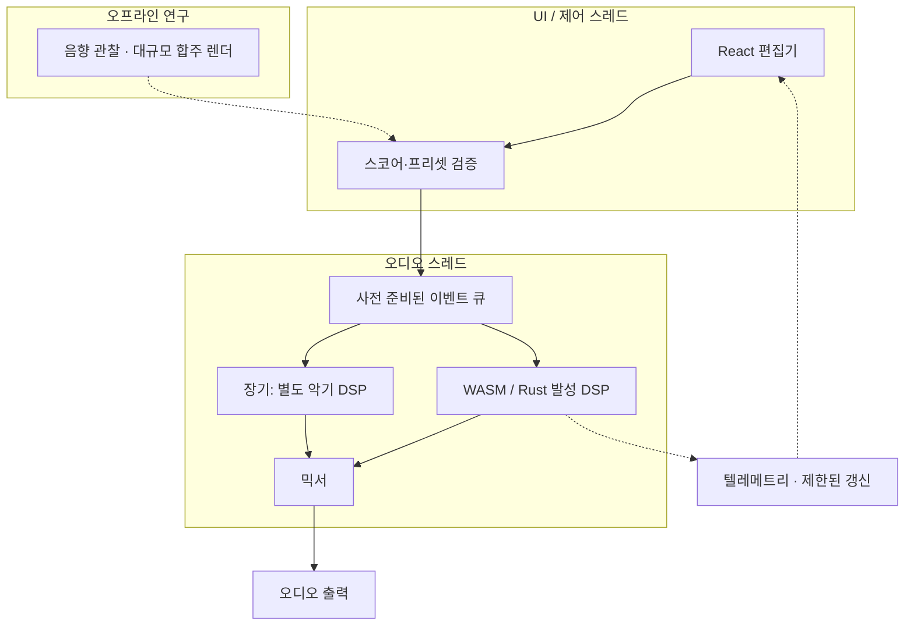

# MVS 시스템 아키텍처

## 1. 현재 기반과 신규 계층

~~~mermaid
flowchart TB
 UI[React / Vite UI] --> TL[신규 MVS 타임라인 및 프리셋]
 VH[신규 Voice Homage 로컬 연구] --> TL
 TL --> G[기존 음소 및 가창 계획기]
 TL --> MR[Web Audio MR 재생]
 TL --> VI[장기: 가상 악기 및 연주 제어]
 VI --> MX
 G --> ABI[WASM ABI / AudioWorklet]
 ABI --> H[기존 인간 발성 엔진]
 ABI --> C[신규 고양이 CreatureSim]
 ABI --> B[신규 하이브리드 발성기]
 H --> DSP[FDTD 기도 / 성문 소스]
 C --> DSP
 B --> DSP
 DSP --> MX[보컬 및 반주 믹서]
 MR --> MX
 DSP --> TELE[텔레메트리 / 2D·3D]
 TELE --> UI
 MX --> OUT[스피커 / 오프라인 렌더]
~~~

현재 저장소의 실제 코드에 기반한 계획이다. 아래 신규 요소는 미구현이다.

| 기존 경로 | 연결 계획 |
|---|---|
| crates/chimera/src/creatures/mammal.rs | 포유류 기도 생성, 난류 및 성문 구동 |
| crates/chimera/src/creatures/seal.rs | 호출 프리셋 및 파라미터 구현 참고 |
| crates/chimera/src/creatures/mod.rs | 신규 cat 등록 |
| crates/chimera/src/creatures/types.rs | CreatureDef, CreatureSim, call plans |
| crates/chimera/src/sources/glottis.rs | 성문 파형과 저주파/거친 발성 연구 |
| crates/chimera/src/airway/network.rs | 물리 음향 네트워크 |
| crates/chimera/src/anatomy/human.rs | 인간 형상과 조음 기반 |
| crates/chimera/src/voice/human_voice.rs | 하이브리드 가창의 확장 후보 |
| crates/chimera/src/phonetics/korean.rs | 한국어 가사 발음 |
| crates/chimera/src/phonetics/sing.rs | 음표 기반 제스처 및 멜리스마 |
| crates/chimera/src/control/singer.rs | 실시간 음절 커서/노트 제어 |
| crates/chimera-cli/src/render.rs | 오프라인 render notes/creature 어댑터 |
| crates/chimera-wasm/src/ | 외부 제어 계약 |
| src/wasm/, src/worklet/ | 타입/ABI 동기 및 실시간 오디오 |
| src/ui/singing.ts | 가창 UI, 재생 및 피아노 롤 확장 |
| tools/musicxml-to-notes.ts | 악보 변환 재사용 |
| src/rig/ | 가상 생물 발성 동작 시각화의 참고 |

기존 creature 경로는 동물 호출용, 인간 singing 경로는 언어와 조음 제스처용이다. 단순 등록만으로 고양이가 인간 가사를 발음할 수 없다. 고양이풍 인간 가창의 1차 구현은 인간 voice에 독립적 스타일 제어를 추가하여 조음 경로를 살린다. 진짜 종간 공통 인터페이스는 이후 연구한다.

## 2. 신규 모듈 후보

- Rust: cat.rs, feline_hybrid.rs, 프로젝트 score/timeline 변환 계층. 핵심 엔진은 I/O 없는 DSP로 유지한다.
- TypeScript: src/mvs/project.ts, importers/, timeline.ts, mixer.ts, preset.ts, src/ui/mvs/ 등. 실제 파일 배치는 구현 시 결정한다.
- CLI: 기존 render notes 경로의 어댑터부터 시작한다. 향후 MVS 프로젝트 전체 렌더 명령을 명시적으로 추가한다.
- Voice Homage 연구: 오디오 콜백 외부의 로컬 음향 관찰 및 프리셋 설계 계층. 엔진에는 검증된 제어값만 전달하며 원본 개인 녹음 및 프리셋의 공개는 기본 비활성화한다. [연구 범위](VOICE_HOMAGE.md).
- 가상 악기 연구: 별도 물리 모델링 악기 모듈과 공통 스코어·제스처·트랙 믹서. AI 작곡·편곡·지휘는 선택적 외부 계층. 기존 보컬 엔진과 분리하여 연산하고 동일 샘플 시간축으로 연결한다. [상세 연구](VIRTUAL_INSTRUMENTS.md).
- IRIS 연동: 선택적 요청 객체 {text, language, voicePreset, emotion, prosody} 및 렌더/취소/진행 이벤트. 네트워크 없이도 동작하는 기본 경로를 유지한다.

## 3. 실시간 계약

오디오 스레드에서 메모리 할당, 파일/네트워크 I/O, 잠금, JSON 파싱, 대규모 토폴로지 재구축 금지. 스코어와 프리셋을 사전에 검증하고 고정 용량 이벤트 큐에 프레임 단위로 공급한다. UI↔Worklet 메시지 계약 변경 시 버전과 Rust/TS 타입을 함께 변경한다. 초과 부하에는 합성 음성을 줄이거나 오프라인 모드로 전환하며 데이터 유실/NaN을 감춘 채 계속 재생하지 않는다. 출력은 유한하며 기기 샘플레이트와 블록 크기 변경에도 안정적이어야 한다. 기존 rust-engine.md 계약을 따른다.

### 제어·렌더링 스레드 경계

오디오 콜백 내부에 파일 I/O, AI 호출 또는 토폴로지 재구축을 두지 않는 제안이다.

## 4. 스튜디오 UI

좌측: 발성 종/프리셋 및 고양이 비율, 골골송, 비브라토, 호흡감, 거칠기, 비강. 중앙: 피아노 롤, 음표별 음절, 음소/피치 곡선 및 MR 파형, 재생 헤드. 우측: 2D 발성기관 단면 및 선택적 3D 머리, 기도 압력/유량과 성문 개폐. 하단: 운송 제어, 보컬/MR 믹서, 내보내기. 자동 정렬의 저신뢰 구간을 색상과 텍스트로 표시하고 키보드 편집도 제공한다.

실제 물리량을 표시할 수 없으면 추정 또는 모형으로 표기한다. 3D의 애니메이션이 오디오의 원인인지 결과 시각화인지 구분한다. 다중 발성체의 합창은 각자의 시드와 미세 타이밍 차이를 유지하고 오프라인 렌더를 우선한다.
