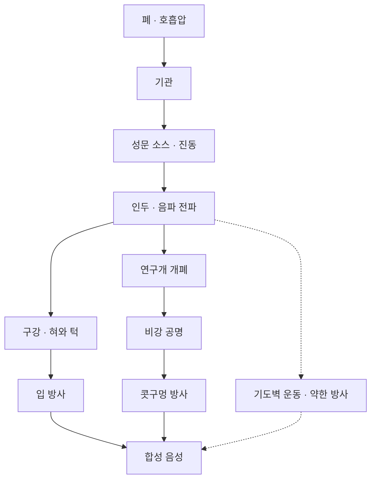
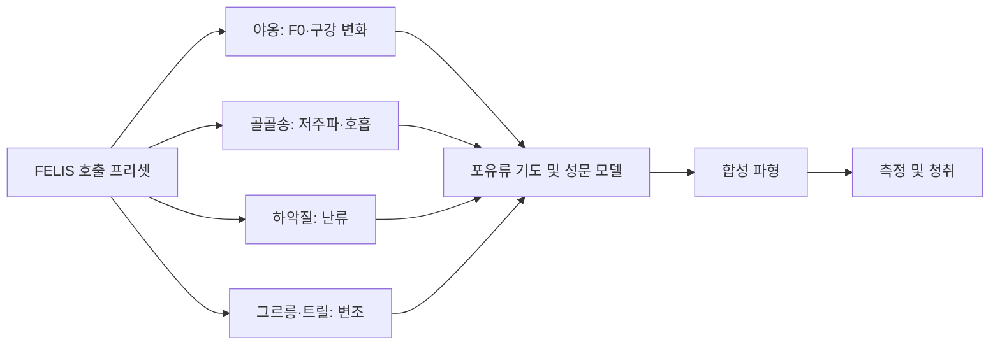
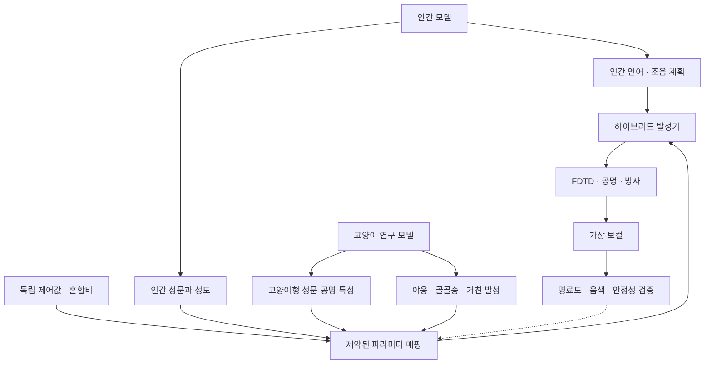

# 생체음향 및 하이브리드 발성 설계

상태: 제안. 고양이 기관의 실제 길이, 단면적, 조직 상수는 수집·검증 전이며 아래의 수치 예시는 생물학적 측정값이 아니다.

## 1. 물리 엔진

기본 토폴로지: 폐 압력 → 기관 → 성문 → 인두 → 구강/비강 → 방사 음향. CHIMERA의 분기형 FDTD(유한차분 시간영역) 네트워크는 압력 노드와 유량 브랜치를 통해 손실, 벽의 운동, 좁은 통로의 난류, 공명과 시간 가변 단면을 계산한다. 현재 성문 소스는 주로 파라메트릭 모델이며 완전한 조직 유체-구조 연성 해석은 아니다. 기존 설계는 작은 동물에 192 kHz 내부 연산을 고려하지만, 실제 MVS 설정은 기기 출력률과 안정성에 따라 결정한다.

개념식: dP/dt = (rho*c^2/V)*(Qin-Qout-Qwall-dV/dt). 단위계와 손실 항은 기존 Rust 구현의 계약을 따른다. F0는 성문 소스의 주기이며 포먼트는 성도의 공명이다. 단순한 고음 처리만으로 고양이의 발성이 되지는 않는다.

### 발성기관 및 음향 경로

포유류 음향 경로의 개념도. 해부학적 단면의 정확한 재현이나 조직 연성 해석을 의미하지 않는다.

## 2. FELIS — 고양이 모델

새 파일 후보: `crates/chimera/src/creatures/cat.rs`. `mammal.rs`의 MammalSpec(기관·인두·구강·비강), MammalAirway, mammal_noise, step_glottis를 재사용하고 CreatureSim 및 CreatureDef로 등록한다. 종 고유의 구강 단면 함수, 성문 설정, 조음 제약과 호출 프리셋을 추가한다.

| 모드 | 구현 가설 | 검증 |
|---|---|---|
| Meow / 먀용 | 성문 F0 곡선, 구강 개폐, 공명 이동 | F0 궤적, 지속시간, 스펙트럼 |
| Purr | 저주파 발성 소스, 호흡 양방향의 게이트/압력, 방사 | 저주파 주기와 호흡별 지속성 |
| Hiss | 성문/구강 협착의 난류, 무성음 | 스펙트럼과 무성 구간 |
| Growl | 저음, 불규칙 진동과 잡음 | 주기성/거칠기 |
| Chirp / trill | 짧은 F0 및 진폭 변화 | 발성 길이와 변조 |
| Kneading | 골골송과 호흡의 표현 프리셋 | 음향과 캐릭터 동작 동기 |

골골송은 단순 25 Hz 효과음이 아니다. 2023년 연구 *Domestic cat larynges can produce purring frequencies without neural input* (Current Biology, DOI: [10.1016/j.cub.2023.09.014](https://doi.org/10.1016/j.cub.2023.09.014))는 적출 후두에서 낮은 주파수의 자발적 진동 가능성을 보고했다. 살아 있는 개체의 신경·호흡 제어를 모두 설명했다는 뜻은 아니다. 실제 구현은 우선 근사 소스와 측정 비교로 시작한다.

해부학 프로필에는 종, 출처, 단위, 측정 범위, 불확실성 및 실험 버전을 기록한다. 생체 실험 없이 공개 연구 및 적법한 관찰 음원으로 검증한다. 자연 발성은 인간 언어를 이해하거나 발음하는 능력을 전제하지 않는다.

### 고양이 호출별 물리 경로

고양이 호출 및 신규 모델은 연구 가설이며 미구현이다.

## 3. FELINE-01 — 인간·고양이 혼합

인간 조음기(혀, 입술, 턱, 연구개)와 언어 프런트엔드가 발음을 계획하고, 고양이형 성문 특성·성도 형상·운율을 독립적으로 적용한다. 두 음성 WAV를 혼합하는 것과 기관 모델을 혼합하는 것은 다르다.

| 제어 | 범위(설계 예시) | 의미 |
|---|---|---|
| felineRatio | 0..1 | 스타일 매크로, 유전학적 비율 아님 |
| anatomyMix | 0..1 | 검증된 기도 형상 경로의 혼합 |
| glottisMix | 0..1 | 성문 파형/발성 특성 |
| purr | 0..1 | 저주파 질감 강도 |
| vibrato | 0..1 | 음악적 비브라토 강도 |
| breathiness | 0..1 | 기식음 강도 |
| roughness | 0..1 | 비주기성/거칠기 |
| nasalColor | 0..1 | 비강 개방·공명 조정 |
| pitchRange | Hz 범위 | 종/프리셋의 허용 발성 범위 |

0%는 기존 인간 모델과 일치하는 회귀 기준이다. 100%의 자연 고양이 모드에는 인간 조음이 불가능할 수 있다. 가상 언어 가능 고양이는 별도 fantasy 프로필이며 생물학적 사실로 표현하지 않는다. 하이브리드는 기존 BodyMix(여성/아동 축)와 독립적인 새 축으로 두고, 종 간 토폴로지를 무조건 보간하지 않는다. 길이·단면은 양수 제한, 성문 및 접촉 조건, 최대 변화 속도를 보장한다. 토폴로지 변경은 오디오 콜백 바깥에서 준비하고 필요 시 크로스페이드한다.

골골송과 노래의 F0가 동시에 안정적으로 유지되는지는 별도 연구 가설이다. 초기에는 보컬의 진폭/소스 변조 또는 독립 합성 레이어를 사용하고, 물리적으로 동일한 성대에서 두 음높이가 나왔다고 주장하지 않는다.

### 인간·고양이 하이브리드 제어

혼합비는 엔진 제어값이며 유전학적 비율이 아니다. 인간 조음을 보존하고 별도 음향 검증을 거친다.

## 4. 조음 재보정

한국어부터 음소별 혀 위치와 포먼트를 목표로 최적화한다. 모음 명료도, 자음 폐쇄/마찰음, 비음, 받침, 연음과 조음 전이를 평가한다. 사람 같은 말과 고양이다운 소리 사이에 상충이 있으므로 스타일과 발음 명료도를 별도 점수로 관리한다. 기본 인간의 golden fixture는 유지하며 새 모델은 독립 fixture를 가진다.
