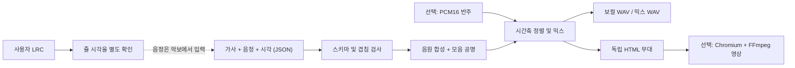
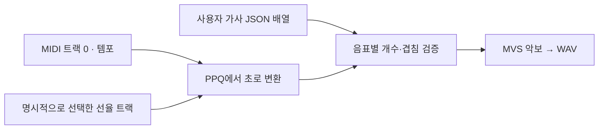
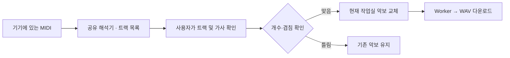
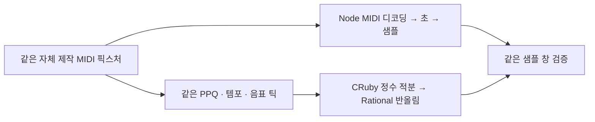
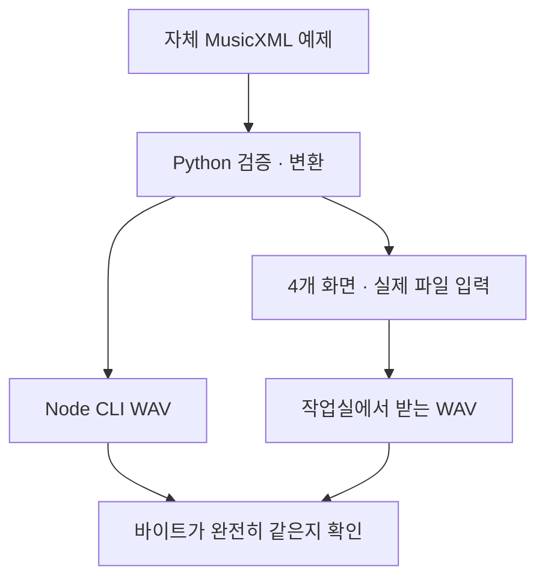
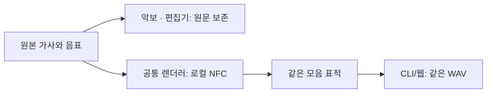
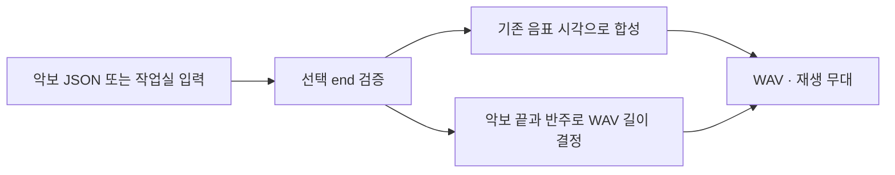
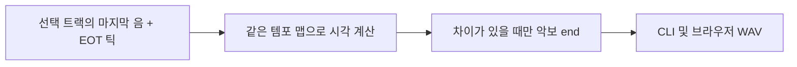
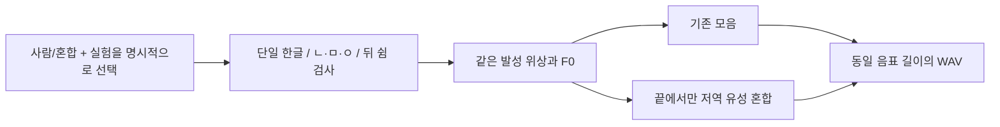

# 개발기 · 먀용의 첫 녹음실

## 뭐가 실제로 돌아가나요?

사용자가 지정한 시작·길이·MIDI·가사를 한 악보에 묶어 브라우저와 CLI에서 같은 합성기로 WAV를 출력한다. 실시간 서버, 배포된 가사 본문, 실존 화자 샘플을 필요로 하지 않는다. 반주 PCM16 WAV가 있으면 0초를 기준으로 맞추고 보컬·믹스를 분리한다. `show`는 WAV를 내장한 재생용 HTML, `film.py`는 그 무대와 WAV를 결합한 재생 영상이다.



## 왜 이 순서였나요?

- **정밀 후두와 타이밍 문제를 분리했다.** 모음 공명 3개, 성문 주기 근사, 소스·필터의 독립 제어로 신호 경로를 단순화했다. 고양이풍, 인간풍, 혼합은 서로 다른 구성이지만 인체 발음이나 고양이 장기를 그대로 재현하지 않는다. 골골송 24 Hz는 [발성 근거](FELINE_EVIDENCE.md)에서 착안한 합성값이지 개체 관측치가 아니다. 하악질은 무성 잡음이라 음높이 재현용 모드가 아니다.
- **타이밍과 음정은 다른 데이터다.** 가사 제공처의 LRC 줄 시작을 음표로 끼워 맞추면 보컬이 틀린 음을 정확하게 부르게 된다. 그래서 LRC 미리보기는 별도 표시하고, 실제 음정은 입력 악보에서만 받는다. 공개 LRCLIB 조회는 메타데이터만 허용한다. 벅스·Musixmatch·LyricFind는 공개 페이지와 계약형 경로를 구분했고 키 없이 가사 제공이 된다고 쓰지 않았다.
- **화면은 갸루, 계산은 작업자.** 브라우저 합성은 별도 Worker에서 수행하고 음원 결과만 돌려받는다. 분홍·보라·노랑, 선글라스 냥이와 한국어 컨트롤은 새 작업실에 일관되게 적용했다. 화면 폭이 좁으면 카드가 아래로 흐른다. OS 파일 선택 창과 원본 CHIMERA 화면의 외형은 바꾸지 않았다.
- **원본을 지운 게 아니다.** GitHub 포크 네트워크에서 분리된 이력과 MIT 원본 고지를 유지했다. 원본 Rust 엔진과 보관 기술 문서는 그대로이며, 한국어 [원본 기술 지도](CHIMERA.md)를 붙였다. 새 작업실은 Node와 브라우저에서 재현되는 별도 실험판이다.

## 확인한 결과

| 검사 | 관측 |
| --- | --- |
| Node 단위 및 CLI | 악보 범위·겹침, 3개 보컬·5개 고양이 호출, A4 기본음, 반주 리샘플, PCM16, LRC, HTML, 입력 오류 |
| Chromium | 1440·768·375·320 px. 가로 넘침 없음; 예제·편집·LRC·고양이 호출·반주·WAV 다운로드 통과 |
| 브라우저와 CLI 일치 | 동일한 실험 악보/반주, PCM16 모노 44.1 kHz, 4초, 176,400프레임. 4개 화면과 CLI가 SHA-256 `640c18f23538e46e54578a2cd2e443d25d5cf88c5fb9f837482c80a0c93b1a5d`로 일치 |
| 재생 영상 | 실제 4초 무대. FFprobe로 1280×720 · 12 fps · H.264 및 4초 AAC 확인 |
| 가사 메타데이터 | LRCLIB v2 호출 성공, 검색 후보 반환. [외부 검증 한계](LYRICS_PROVIDERS.md) |


[모바일 375 px 화면](assets/studio-mobile.webp) · [작업실 사용법](STUDIO.md)

## 남은 검증

원본 Rust/WASM의 전체 회귀·라이브 호스트 검증은 이 독립 작업실 검사에 포함하지 않았다. MRI 기반 기도 재현, 실제 고양이 청취표, 한국어 자음·연음, MIDI/MusicXML 가져오기, 다성 합창, 사람 목소리 분석, 가상 오케스트라는 [연구 로드맵](ROADMAP.md)이다. 데스크톱 Chromium의 작은 화면 검사는 실제 안드로이드·아이폰 음향 지연이나 성능 측정을 대신하지 않는다.

## 밤샘 1 · MIDI의 박자와 가사를 분리해 가져오기

악보 입력이 JSON뿐이면 DAW에 있는 선율을 손으로 옮겨야 했다. 우선 명령줄에서 표준 MIDI의 트랙 목록을 확인하고 트랙 하나와 별도 가사 배열을 명시적으로 결합하게 했다. 음표를 바꾸거나 틀린 개수를 자동 보정하는 것보다, 타임라인을 그대로 유지하고 명확한 오류를 내는 쪽을 선택했다. 표준 형식 1의 컨덕터 트랙 템포를 적분해 음표 중간의 템포 변경을 반영한다. 피치벤드, 페달, 내장 가사, SMPTE, 화음은 별도 지원 과제다.



00:23에 시작한 작업은 예약 정정 요청 때 푸시하지 않고 정지했다. 재개 후 테스트에서 미구현 CLI 명령이 종료 코드 2로 실패하는 것을 먼저 확인했다. 자체 제작 형식 1 픽스처에서 한 음을 두 템포에 걸쳐 유지해 정확히 1.5초를 계산했고, CLI가 생성한 WAV에서 44.1 kHz 기준 66,150프레임을 확인했다. `node --test studio/tests/*.test.mjs`로 다시 검증한다. Ruby는 이 실행 환경에 설치돼 있지 않아 구현과 비교를 아직 시작하지 않았다.

## 밤샘 2 · 작업실에서 MIDI를 직접 열기

CLI 변환 파일을 매번 만들지 않아도 작업실에서 같은 MIDI 해석기를 쓰도록 했다. 파일을 먼저 읽고 트랙과 음표 수만 보여 준다. 가사 개수가 맞고 겹침 검사를 통과해 **적용**을 누른 경우에만 기존 악보와 그 악보의 오디오 미리보기를 교체한다. 파일을 바꾸면 늦게 끝난 앞선 읽기는 폐기한다. 아직 MIDI를 원곡 발음으로 알아서 맞추거나 MusicXML을 읽지는 않는다.



브라우저 시나리오를 먼저 추가했다. 기존 정적 빌드에는 MIDI 입력이 없어 테스트가 제한 시간 내에 진행하지 못했다. 새 UI와 모듈을 패키징한 뒤 같은 테스트를 데스크톱 1440, 태블릿 768, 모바일 375와 320 px에서 다시 실행했다. 가사 한 줄 누락 시 기존 5음표가 남고, 두 줄을 맞추면 MIDI 72의 두 번째 음이 정확히 0.75초에 배치됐다. 반주 없이 새 음원을 다운로드해 44.1 kHz, 55,125프레임(1.25초)을 읽었다. 이전 반주 믹스의 네 화면 해시도 그대로 일치했고 Node 14/14를 유지했다. 실제 모바일 기기로 별도 시험한 결과는 아니다.

## 밤샘 3 · 루비가 악보의 같은 지점을 짚는지 확인 💎

먼저 작업 규칙을 [별도 문서 PR](https://github.com/hslcrb/meow-voice-system/pull/3)로 정했다. 한 가지 변경만 담고 최신 head에서 리뷰와 검증 근거를 남긴다. 자기 PR에서는 승인 대신 검토 코멘트를 쓴다. 이 실험은 렌더 엔진을 바꾸지 않고 음표의 시작·끝을 샘플 인덱스로 바꾸는 핵심 경로만 Ruby로 옮긴다.

처음에는 네이티브 `ruby` 명령이 없었다. 대신 [공식 ruby.wasm의 Node 사용법](https://github.com/ruby/ruby.wasm/blob/main/docs/cheat_sheet.md#nodejs)을 확인하고, 저장소 밖 임시 폴더에 고정 버전 두 패키지만 설치했다. 그 런타임으로 CRuby 4.0.0 wasm32-wasi를 실제 실행했다. 첫 비교 스크립트는 Ruby 모듈이 없어서 실패했다. 구현 후 같은 테스트를 다시 돌렸다.

Ruby는 템포 구간 면적을 정수로 누적하고 마지막 한 번만 유리수로 나누어 반올림한다. 출력은 시작 포함·끝 제외 샘플 창이다. 기존 Node 해석기는 표준 MIDI 파일에서 직접 음표를 읽었고, Ruby에는 그 파일에 쓰인 같은 PPQ·틱·템포를 전달했다. 두 경로가 중간 템포를 지나는 음의 `[0, 66150]` 프레임을 일치시켰다. 기본 템포, 선행 쉼, 정확한 경계, 잘못된 PPQ와 정렬된 템포 요구도 확인했다.



| 관측 | 3회 중앙값 | 범위 |
| --- | --- | --- |
| Ruby WASM 준비 | 403.68 ms | 387.13–552.15 ms |
| Ruby 시간 변환 10,000회 | 100.42 ms | 97.67–104.55 ms |
| Node MIDI 전체 해석 10,000회 | 21.07 ms | 16.15–23.03 ms |

두 반복은 서로 다른 작업 범위다. 수치는 이 환경의 대략적 실행 비용이며 언어 일반 성능 비교가 아니다. 브라우저와 기본 CLI에 WASM 다운로드나 Ruby 초기화를 추가하지 않았다. Ruby 버전은 작은 참조 구현으로 두고, 실행 의존성을 추가할 만큼 현재 대체 이점은 확인되지 않았다.

```sh
runtime=$(mktemp -d)
npm install --prefix "$runtime" --ignore-scripts --no-audit --no-fund --no-package-lock \
  @ruby/4.0-wasm-wasi@2.10.1 @ruby/wasm-wasi@2.10.1
node studio/experiments/compare-timing.mjs "$runtime"
```

통합 음성 합성, 전체 MIDI 바이트 파서, Ruby 네이티브 벤치마크까지 Ruby에서 확인한 것은 아니다.

### 밤샘 4. MusicXML의 악보에 이미 적힌 음정과 가사만 가져오기

입력 축을 하나 더 연결했다. MIDI는 선율과 사용자 가사 배열을 따로 받지만, MusicXML은 한 파일에 기보 시간·음높이·가사가 있는 경우를 먼저 다룬다. 브라우저 XML 파서와 정적 앱에 변환을 중복 구현하는 대신, Python 표준 라이브러리로 검증하는 작은 CLI부터 시작했다. 결과는 기존 작업실 JSON이므로 같은 Node 렌더러·브라우저의 JSON 입력을 쓴다. Rust 엔진과 기존 WAV·MIDI 경로는 안 건드렸다.

4분음표당 단위인 [divisions](https://www.w3.org/2021/06/musicxml40/musicxml-reference/elements/divisions/)와 [sound tempo](https://www.w3.org/2021/06/musicxml40/musicxml-reference/elements/sound/)에 따라 각 음표의 `duration / divisions × 60 / BPM`을 계산한다. 단위나 BPM이 바뀌어도 이미 계산한 시간은 되감지 않는다. 붙임줄은 시각 표시용 `<tied>`가 아닌 [재생을 정의하는 `<tie>`](https://www.w3.org/2021/06/musicxml40/musicxml-reference/elements/tie/)가 기준이다. 연결 양쪽의 실제 음높이가 같아야 하고 이어지는 음에 가사를 다시 적지 않아도 된다. 계산 중에는 40자리 십진 정밀도를 사용한 뒤 최종 JSON에서만 초 단위 부동소수점으로 바꾼다.


처음에 테스트 4건을 먼저 만들고 실행하자 변환기가 없어서 4건이 모두 실패했다. 구현 뒤에는 긍정 경로 두 건이 통과했지만, 거절 사유의 ‘템포’와 ‘파일 크기’처럼 사용자가 찾아야 할 단어가 오류에 없어서 한국어 오류 계약은 실패했다. `sound tempo` 문법은 남기되 ‘템포’를 함께 적고 상한도 파일 크기임을 분명히 한 뒤 재실행했다. 끝 쉼표를 잘라 버리고 성공 처리하는 대안은 버렸다. 현재 JSON은 마지막 음까지로 길이가 정해지므로 끝 쉼표가 있으면 변환기에서 중단한다. 여러 파트의 공통 템포 해석, 압축 MXL, 악보 앱이 덧붙이는 DTD, 비기보 실연 표현과 직접 브라우저 XML 입력도 후속 범위로 분리했다.

예제는 직접 만든 두 음의 악보로만 검증했다. A4 `0.25–1.25초`가 서로 다른 속도의 두 마디를 잇고, 쉼표 `1.25–1.50초` 뒤 C♯4 `1.50–2.25초`가 난다. `node --test studio/tests/*.test.mjs` 18건에서 음정 번호·구간 무음·A4 주기와 오류·덮어쓰기 거절을 확인했다. 예제 명령을 별도로 실행해 FFprobe에서 PCM16LE 모노 44,100 Hz, 99,225 샘플, 2.250000초를 읽었다. WAV SHA-256은 `2aa510ed4925c7fa5daac162cd15820adeae09da4e6f304ab14b0589f738dd7c`다. 이 수치는 파일과 음정 경로를 검증한 것이지 한국어 발음의 자연스러움이나 시중 악보 전체 호환성을 입증하지 않는다.

### 밤샘 5. 악보 두 음을 CLI와 모바일 브라우저에서 같은 파일로 재생

[#5](https://github.com/hslcrb/meow-voice-system/pull/5)의 원격 병합 SHA는 `96a7c82aa57a896f265062e16be35de5e91c8463`이다. 수동으로 확인한 브라우저 경로를 매번 실행 가능한 회귀 검사로 옮겼다. 테스트가 원본 예제를 Python으로 변환하고 Node CLI로 WAV를 만든다. 이어 1440·768·375·320px Chromium 각 화면에서 같은 JSON을 실제 파일 입력으로 올리고 가사·음정·시각을 확인한 후 받은 WAV가 CLI WAV와 바이트 단위로 같은지 확인한다.

첫 브라우저 시도에서는 이전 작업 환경의 Chromium 경로가 이 실행에서 없었고, 독립 런타임을 준비해 재시도하자 LRC 이전 검사의 즉시 `count()`가 비동기 파일 읽기보다 빨리 호출돼 실패했다. 렌더러나 가사 파서는 바꾸지 않았다. 고정 시간을 더 기다리는 대신 지정한 목록에 두 줄이 실제로 도착했을 때 통과하는 Playwright 조건으로 바꿨다. 이 상태에서 4개 화면을 3회 연속 실행해 총 12번 통과했다. 종전 반주 WAV 해시는 `640c18f23538e46e54578a2cd2e443d25d5cf88c5fb9f837482c80a0c93b1a5d`, 새 MusicXML 경로의 WAV 해시는 `2aa510ed4925c7fa5daac162cd15820adeae09da4e6f304ab14b0589f738dd7c`로 고정됐다. Node 테스트 18건도 그대로 통과했다.



[375px 실제 작업실 스틸](assets/studio-musicxml-mobile.webp): 위 목록에 `먀` A4와 `용` C♯4가 원본의 시각 그대로 보이고, 아래에 `2.25초 · 44,100 Hz` 결과가 표시된다. Playwright Chromium 캡처 옵션으로 재생성할 수 있다. 스틸은 파일 불러오기와 작업실 화면의 증거이며, 음성 자연스러움이나 물리 휴대폰 성능은 입증하지 않는다.

### 밤샘 6. 같은 한글은 같은 파형: 글자는 보존하고 합성만 바로잡기

완성된 음절 하나인 `이`와 초성·중성으로 분해한 같은 `이`는 보이는 글자가 같아서 악보 편집만으로는 문제가 잘 안 드러난다. 기존 합성기는 코드 포인트부터 펼치고 완성된 한글 범위에서 모음을 찾았다. 분해한 자모를 각각 읽으면 원래 모음이 아닌 기본 /a/로 빠졌다. 실제 PCM WAV를 만들어 보니 세 단어(이·냐옹·뿌리)와 세 보컬(고양이·사람·혼합)의 9개 비교에서 모두 두 표기의 파형이 달랐다. 같은 보컬에서 분해형 세 단어가 서로 같은 WAV가 되는 문제도 확인했다.

해결책은 모든 입력을 덮어쓰거나 [Unicode 정규화](https://www.unicode.org/reports/tr15/)의 호환 정규화로 범위를 넓히는 것이 아니었다. 작업실의 공통 음원·필터 렌더러가 **모음 표적을 고르기 직전에만** NFC로 합친다. 악보 JSON·화면·가사 원문·음정·초 단위 시각은 그대로다. 이 변경은 한국어 자음·받침 모델이나 고양이 성대 모델을 개선한 것으로 해석하지 않는다.



회귀 검사를 먼저 추가하고 구현 없이 실행했을 때 고양이풍 `이`에서 바이트가 달라 실패했다. 전체 배열을 출력하면 실패 로그가 과하게 커졌으므로 바이트를 비교하면서 보컬과 문구만 보여주는 단언으로 바꿨다. 수정 후 Node 테스트 19건 통과, 9가지의 WAV 일치·가사 원문·앞 1,920 무음 샘플과 전체 8,640 샘플 유지 확인. Chromium 1440·768·375·320px에서 기존 반주와 MusicXML 기준 WAV 해시는 바뀌지 않았다. 375px에서 분해형 JSON을 실제 선택해 편집기 입력값의 자모와 새 다운로드 링크를 확인했으며, 새로 받은 WAV는 완성형 CLI WAV와 바이트 단위로 같았다.

### 밤샘 7. 노래가 끝나도 악보는 아직 끝나지 않을 수 있다

[#7](https://github.com/hslcrb/meow-voice-system/pull/7)의 합성기 정규화가 원격 `54cf9484809591c45d0a1ea8e4cb298a6d2d95f9`에 병합됐고, 이어 시간 표현의 빈칸을 보강했다. 지금까지 작업실 JSON에는 마지막 음표 뒤의 무음을 담을 방법이 없었다. 소리를 안 내는 가짜 음표와 가사를 생성하거나 포맷마다 WAV에 직접 무음을 채우는 대안은 버렸다. 가사가 시각화에 잘못 표시되거나 HTML·브라우저·WAV의 시간 계약이 달라지기 때문이다.

선택적 최상위 필드 `end`는 초 단위 악보 끝이다. 마지막 음이 끝난 시각 이상이며 300초를 넘지 않는다. 소수점 덧셈의 표현 차이는 기존 음표 시간 검사와 같은 허용 오차로 취급한다. 합성 길이는 악보 끝, 실제 마지막 음표 끝, 반주 길이 중 가장 긴 값이다. WAV의 말미가 늘어날 뿐 앞선 음표의 생성 위치나 시각적 활성 구간은 바뀌지 않는다. 기존 악보에 `end`가 없으면 유효성 검사 결과나 WAV가 그대로다. 웹에 같은 이름의 제어를 추가해 로딩 후 값을 숨기지 않는다.



두 테스트를 먼저 추가해 변환·CLI에 아직 끝 시각이 없어서 실패하는 것을 확인했다. Node 21건 통과: 16kHz CLI에서 총 12,000샘플 중 마지막 6,000이 무음이고, HTML 무대의 실제 음표 구간도 기존 0.375초에서 닫힌다. Chromium 375px에서 끝 시각 `2.75`가 있는 악보를 선택했을 때 121,275샘플 중 앞 99,225가 2.25초 기준 WAV와 동일했고, 끝 22,050샘플만 무음으로 늘었다. 1초로 바꾸면 기존 마지막 음보다 짧다는 오류가 나고, 비우면 2.25초로 돌아간다. 네 화면 폭의 기존 반주와 MusicXML WAV 해시는 유지됐다. 아직 MusicXML 변환기가 이 필드를 쓰지는 않으므로 변환기 연결은 다음 PR에서 따로 검증한다.

### 밤샘 8. MusicXML 마지막 쉼표를 편집기와 WAV까지 연결

[#8](https://github.com/hslcrb/meow-voice-system/pull/8)에서 도입한 선택적 `end`가 원격 `7f3e59cba5312cb50b4cb7b63128f5ffbf2d6fe6`에 병합됐다. 이제 변환기가 마지막까지 모두 계산하고, 마지막 이벤트가 쉼표라면 그 시점까지 읽은 시간만 `end`로 옮긴다. 뒤에 음표가 더 있는 중간 쉼표는 이전처럼 음표 사이 간격으로만 표시한다. 평범하게 음표로 끝나는 악보는 이전과 동일한 JSON을 생성한다. 별도의 가짜 휴지 음표나 가사를 넣지 않고 5분 상한도 유지한다.


테스트의 첫 실행에는 변환기가 이전 ‘끝 쉼표 불가’ 오류를 반환했다. 수정 후 22건 통과. 0.5초 음 뒤에 BPM 120에서 0.25초, BPM 60에서 0.5초의 쉼표를 연결하자 JSON에는 음표 하나와 끝 `1.25`초만 생겼다. 44.1kHz에서 총 55,125샘플이며 뒤 33,075샘플은 모두 0이다. 5분을 넘긴 입력은 결과물을 만들지 않는다. 웹 375px 검사는 별도 JSON을 손으로 꾸미지 않고 같은 실제 MusicXML 예제에 쉼표를 넣어 변환한 뒤 파일을 선택한다. 네 화면 폭에서 두 기준 WAV 해시를 유지했고, 쉼표 예제에서는 99,225샘플 데이터가 기존과 같고 끝 22,050샘플만 0인 것을 재확인했다.

### 밤샘 9. MIDI의 마지막 쉼표도 작업실에 그대로

[#9](https://github.com/hslcrb/meow-voice-system/pull/9)로 MusicXML 말미는 보존됐지만, MIDI에서는 End of Track의 위치를 읽고도 저장하지 않았다. 재현용 포맷 0에서 마지막 발성은 틱 480, 트랙 종료는 틱 960이었다. 기본 템포와 480 PPQ에서는 1초짜리 트랙이 0.5초 WAV로 줄었다.

트랙 끝은 [MIDI Association의 Standard MIDI Files 설명](https://midi.org/standard-midi-files)에서 다루는 트랙 단위 메타 이벤트를 따른다. 프로그램은 가창용으로 선택한 트랙 하나만 변환하므로 포맷 1 전체의 가장 긴 트랙을 반환하지 않는다. 트랙 0의 템포 맵은 공유하지만, 길이는 선택한 트랙의 종료 틱을 같은 맵으로 초 단위로 바꿔 계산한다. 종료 틱이 마지막 음과 같을 때는 `end`조차 추가하지 않아 기존 JSON/WAV 결과와 호환된다. 나중에 붙는 다른 타임스탬프나 음표용 가사를 만들어 길이를 늘리지 않는다.



먼저 세 회귀가 실패했다. 수정 뒤 Node 25/25: 포맷 0의 44.1kHz WAV는 기존 발성 22,050샘플과 동일한 앞부분에 무음 22,050샘플만 추가했다. 포맷 1은 쉼표 중 템포가 바뀌는 예제에서 선택 트랙 끝 1.5초와 별도 악기 트랙 끝 2.75초를 각각 계산했다. 5분을 넘긴 선택 트랙은 조용히 잘라내지 않고 거절한다. 375px Chromium에서 자체 MIDI를 직접 업로드해 0.5초 음, 악보 끝 1초, 다운로드 WAV의 무음 꼬리를 검증했다. 네 화면 폭의 기존 MusicXML·반주 WAV 해시는 유지됐다.

### 밤샘 10. 모음만 있던 합성에 한국어 비음 받침을 선택형으로 더하기

[#10](https://github.com/hslcrb/meow-voice-system/pull/10)은 선택한 MIDI 트랙 끝을 원격 `c207b38d1794fdd8100cbedb64ecf1750b5e8e1b`에 보존했다. 다음 문제는 시간의 길이가 아니라 짧은 음절 안에서 어떤 소리를 내느냐였다. 기존 모음 경로에선 예를 들어 ‘야’와 같은 모음인 ‘양’의 받침에 전용 발성 처리가 없었다.

[국립국어원 표준 발음법](https://korean.go.kr/kornorms/m/m_regltn.do?regltn_code=0002)의 비음 받침 ㄴ·ㅁ·ㅇ 중 **악보 한 음에 한 음절이고 이후 30ms 이상 비거나 끝나는 경우**만 다룬다. 합성에 들어가는 NFC를 그대로 쓰고, 해당 음 끝의 최대 70ms 또는 길이의 25% 중 작은 범위에 같은 유성 원천의 낮은 대역을 점진적으로 섞는다. 420Hz 저역 통과·길이·혼합률은 듣기나 실제 성도 실측으로 얻은 수치가 아니라 실험 파라미터다. 세 자음의 조음 위치를 다르게 흉내 냈다고 주장하지 않는다. 이어 부르는 음, 여러 음절이 한 음에 붙은 경우, 다른 받침, 영어, 기본값, 고양이 호출은 건드리지 않는다.



회귀를 먼저 실행해 모드가 보존되지 않아 실패하는 것을 확인했다. 이후 Node 26/26: 시작 무음과 앞부분 표본 동일, 대상 끝부분만 변화, 분해형·완성형의 바이트 일치, 비대상 글자·이어지는 음의 무변경 및 안전 범위를 모두 확인했다. 사람풍 A3 ‘양’의 16kHz 로컬 예제는 기본·실험 모두 9,920샘플이었다. 동일한 끝부분을 190–250Hz 정수 간격으로 훑었을 때 가장 큰 위치가 각각 220Hz였고, 880Hz/220Hz 크기 비율은 0.1019 → 0.0904였다. 피크 절대값은 0.4460 → 0.4440. FFprobe는 PCM16LE 모노, 16kHz, 9,920샘플을 읽었다. 이 측정은 좁은 음역 한 예제의 원리 확인이지 전체 음역, 받침 구별 가능성, 발음의 자연스러움 또는 가창자를 검증한 것이 아니다.

실제 375px 브라우저에서 입력 파일을 선택한 뒤 설정의 **비음 받침 실험**을 켜서 받은 WAV가 독립 CLI의 명시적 JSON 결과와 동일했다. 고양이 모드로 전환하면 실험 제어는 숨겨지고 기본 호출이 유지된다. 320·375·768·1440px에서 기본 MusicXML/반주 해시는 바뀌지 않았다. 기존 기본 프리셋 소리를 덮어쓰지 않는 이유다.
