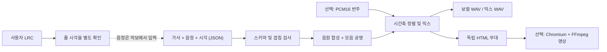
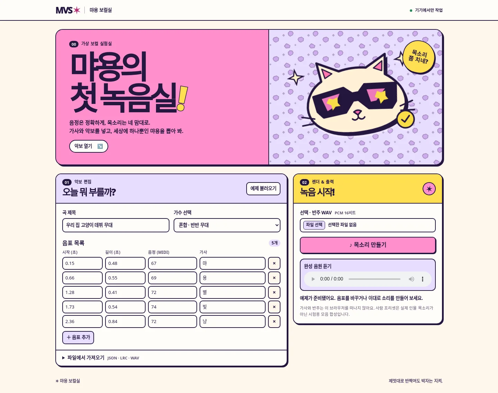
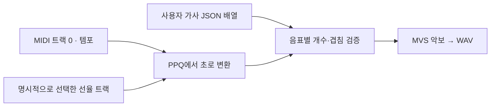
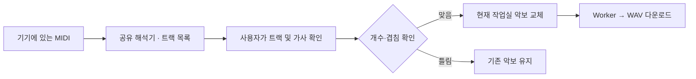

# 개발기 · 먀용의 첫 녹음실

## 뭐가 실제로 돌아가나요?

사용자가 지정한 시작·길이·MIDI·가사를 한 악보에 묶어 브라우저와 CLI에서 같은 합성기로 WAV를 출력한다. 실시간 서버, 배포된 가사 본문, 실존 화자 샘플을 필요로 하지 않는다. 반주 PCM16 WAV가 있으면 0초를 기준으로 맞추고 보컬·믹스를 분리한다. `show`는 WAV를 내장한 재생용 HTML, `film.py`는 그 무대와 WAV를 결합한 재생 영상이다.

## 왜 이 순서였나요?

- **정밀 후두와 타이밍 문제를 분리했다.** 모음 공명 3개, 성문 주기 근사, 소스·필터의 독립 제어로 신호 경로를 단순화했다. 고양이풍, 인간풍, 혼합은 서로 다른 구성이지만 인체 발음이나 고양이 장기를 그대로 재현하지 않는다. 골골송 24 Hz는 [발성 근거](FELINE_EVIDENCE.md)에서 착안한 합성값이지 개체 관측치가 아니다. 하악질은 무성 잡음이라 음높이 재현용 모드가 아니다.
- **타이밍과 음정은 다른 데이터다.** 가사 제공처의 LRC 줄 시작을 음표로 끼워 맞추면 보컬이 틀린 음을 정확하게 부르게 된다. 그래서 LRC 미리보기는 별도 표시하고, 실제 음정은 입력 악보에서만 받는다. 공개 LRCLIB 조회는 메타데이터만 허용한다. 벅스·Musixmatch·LyricFind는 공개 페이지와 계약형 경로를 구분했고 키 없이 가사 제공이 된다고 쓰지 않았다.
- **화면은 갸루, 계산은 작업자.** 브라우저 합성은 별도 Worker에서 수행하고 음원 결과만 돌려받는다. 분홍·보라·노랑, 선글라스 냥이와 한국어 컨트롤은 새 작업실에 일관되게 적용했다. 화면 폭이 좁으면 카드가 아래로 흐른다. OS 파일 선택 창과 원본 CHIMERA 화면의 외형은 바꾸지 않았다.
- **원본을 지운 게 아니다.** GitHub 포크 네트워크에서 분리된 이력과 MIT 원본 고지를 유지했다. 원본 Rust 엔진과 보관 기술 문서는 그대로이며, 한국어 [원본 기술 지도](CHIMERA.md)를 붙였다. 새 작업실은 Node와 브라우저에서 재현되는 별도 실험판이다.

## 확인한 결과

| 검사 | 관측 |
| --- | --- |
| Node 단위 및 CLI | 악보 범위·겹침, 3개 보컬·5개 고양이 호출, A4 기본음, 반주 리샘플, PCM16, LRC, HTML, 입력 오류 |
| Chromium | 1440·768·375·320 px. 가로 넘침 없음; 예제·편집·LRC·고양이 호출·반주·WAV 다운로드 통과 |
| 브라우저와 CLI 일치 | 동일한 실험 악보/반주, PCM16 모노 44.1 kHz, 4초, 176,400프레임. 4개 화면과 CLI가 SHA-256 `640c18f23538e46e54578a2cd2e443d25d5cf88c5fb9f837482c80a0c93b1a5d`로 일치 |
| 재생 영상 | 실제 4초 무대. FFprobe로 1280×720 · 12 fps · H.264 및 4초 AAC 확인 |
| 가사 메타데이터 | LRCLIB v2 호출 성공, 검색 후보 반환. [외부 검증 한계](LYRICS_PROVIDERS.md) |

[모바일 375 px 화면](assets/studio-mobile.webp) · [작업실 사용법](STUDIO.md)

## 남은 검증

원본 Rust/WASM의 전체 회귀·라이브 호스트 검증은 이 독립 작업실 검사에 포함하지 않았다. MRI 기반 기도 재현, 실제 고양이 청취표, 한국어 자음·연음, MIDI/MusicXML 가져오기, 다성 합창, 사람 목소리 분석, 가상 오케스트라는 [연구 로드맵](ROADMAP.md)이다. 데스크톱 Chromium의 작은 화면 검사는 실제 안드로이드·아이폰 음향 지연이나 성능 측정을 대신하지 않는다.

## 밤샘 1 · MIDI의 박자와 가사를 분리해 가져오기

악보 입력이 JSON뿐이면 DAW에 있는 선율을 손으로 옮겨야 했다. 우선 명령줄에서 표준 MIDI의 트랙 목록을 확인하고 트랙 하나와 별도 가사 배열을 명시적으로 결합하게 했다. 음표를 바꾸거나 틀린 개수를 자동 보정하는 것보다, 타임라인을 그대로 유지하고 명확한 오류를 내는 쪽을 선택했다. 표준 형식 1의 컨덕터 트랙 템포를 적분해 음표 중간의 템포 변경을 반영한다. 피치벤드, 페달, 내장 가사, SMPTE, 화음은 별도 지원 과제다.

00:23에 시작한 작업은 예약 정정 요청 때 푸시하지 않고 정지했다. 재개 후 테스트에서 미구현 CLI 명령이 종료 코드 2로 실패하는 것을 먼저 확인했다. 자체 제작 형식 1 픽스처에서 한 음을 두 템포에 걸쳐 유지해 정확히 1.5초를 계산했고, CLI가 생성한 WAV에서 44.1 kHz 기준 66,150프레임을 확인했다. `node --test studio/tests/*.test.mjs`로 다시 검증한다. Ruby는 이 실행 환경에 설치돼 있지 않아 구현과 비교를 아직 시작하지 않았다.

## 밤샘 2 · 작업실에서 MIDI를 직접 열기

CLI 변환 파일을 매번 만들지 않아도 작업실에서 같은 MIDI 해석기를 쓰도록 했다. 파일을 먼저 읽고 트랙과 음표 수만 보여 준다. 가사 개수가 맞고 겹침 검사를 통과해 **적용**을 누른 경우에만 기존 악보와 그 악보의 오디오 미리보기를 교체한다. 파일을 바꾸면 늦게 끝난 앞선 읽기는 폐기한다. 아직 MIDI를 원곡 발음으로 알아서 맞추거나 MusicXML을 읽지는 않는다.

브라우저 시나리오를 먼저 추가했다. 기존 정적 빌드에는 MIDI 입력이 없어 테스트가 제한 시간 내에 진행하지 못했다. 새 UI와 모듈을 패키징한 뒤 같은 테스트를 데스크톱 1440, 태블릿 768, 모바일 375와 320 px에서 다시 실행했다. 가사 한 줄 누락 시 기존 5음표가 남고, 두 줄을 맞추면 MIDI 72의 두 번째 음이 정확히 0.75초에 배치됐다. 반주 없이 새 음원을 다운로드해 44.1 kHz, 55,125프레임(1.25초)을 읽었다. 이전 반주 믹스의 네 화면 해시도 그대로 일치했고 Node 14/14를 유지했다. 실제 모바일 기기로 별도 시험한 결과는 아니다.
