# MVS Diagram Atlas — 연구 도식 모음

MVS의 발성기관, 가창, 개인화, 악기 및 오케스트라를 연결하는 개념도 모음이다. 기존 CHIMERA 엔진과 MVS 신규 연구를 구분하며, 신규 기능은 미구현이다. 도식은 GitHub Mermaid 렌더러용으로 작성했으며 개념 흐름이지 실제 해부학, 성능 측정 또는 구현 완료를 의미하지 않는다.

[기획 문서 홈](README.md)

## 1. 전체 연구 아키텍처

[상세 설계](README.md)

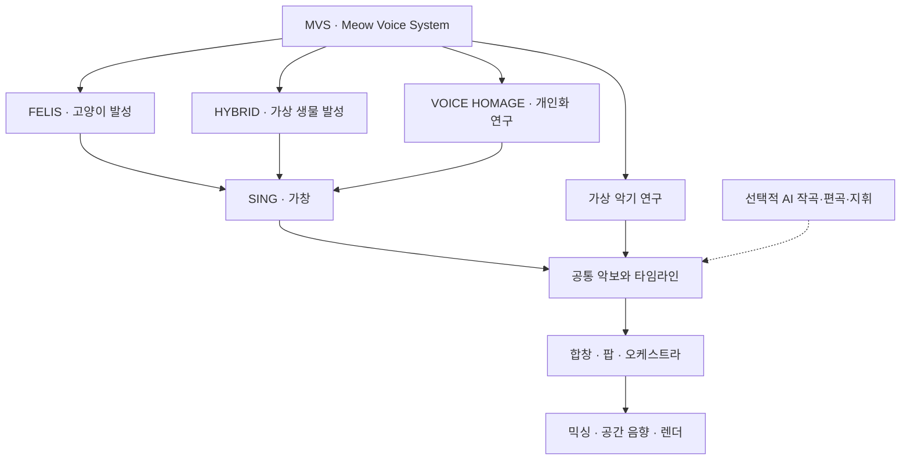

## 2. 연구 비전

[상세 설계](VISION.md)

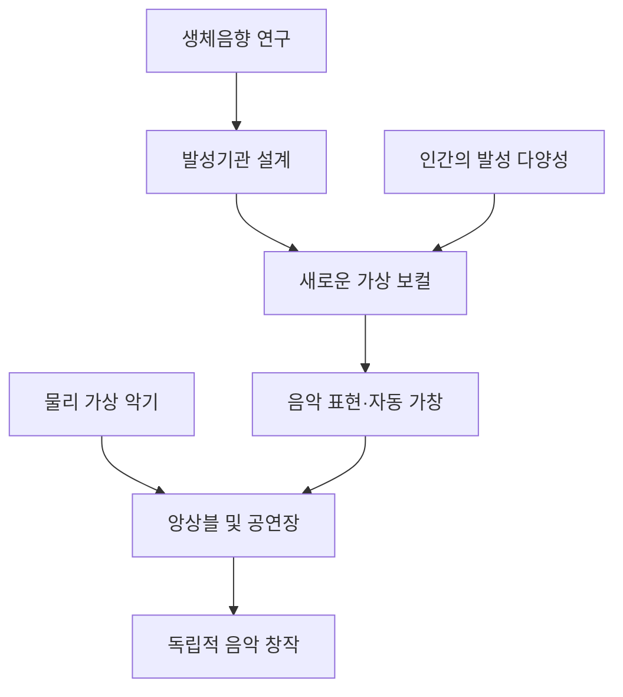

## 3. 포유류 발성기관

[상세 설계](BIOACOUSTICS.md)

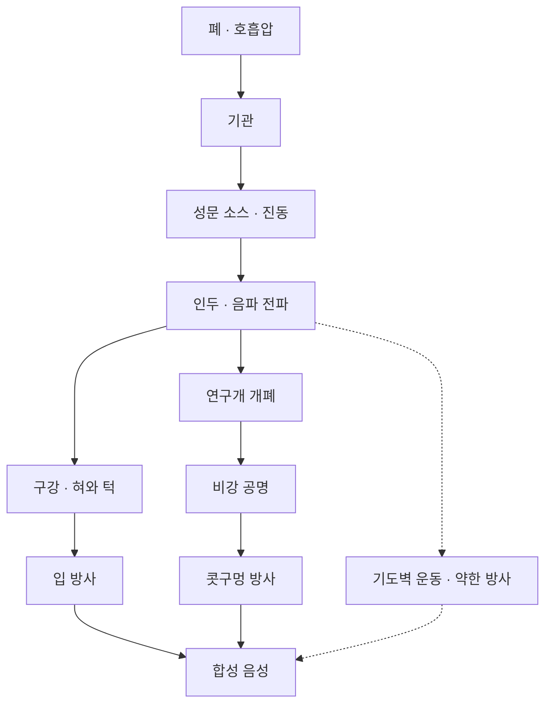

## 4. 고양이 호출 모델

[상세 설계](BIOACOUSTICS.md)

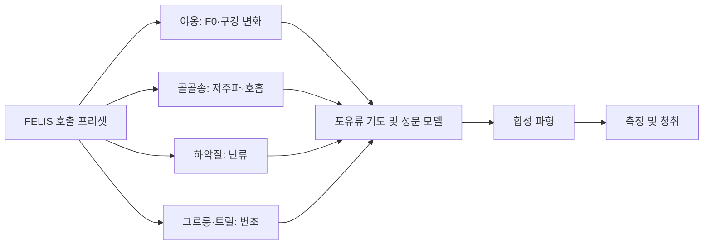

## 5. 인간·고양이 혼합 발성

[상세 설계](BIOACOUSTICS.md)

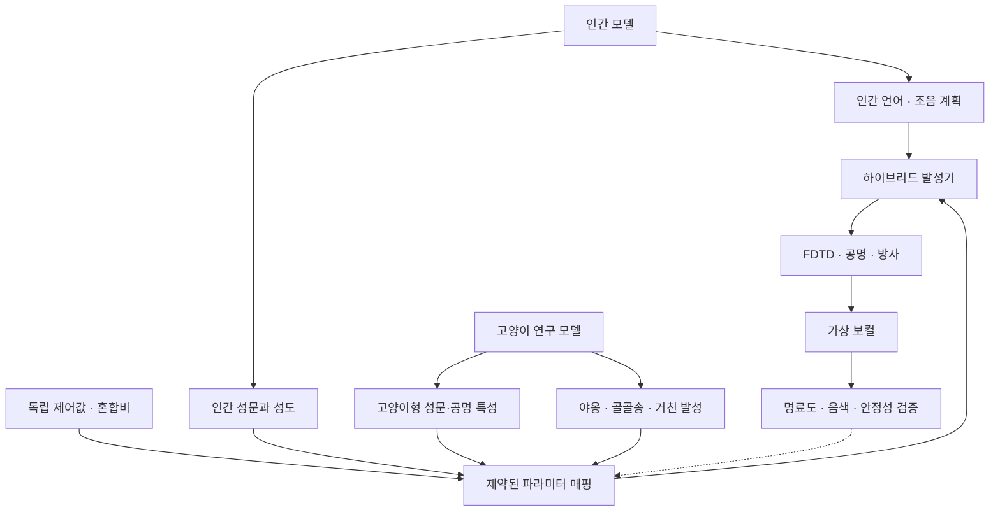

## 6. 자동 가창 및 MR 재생

[상세 설계](SINGING.md)

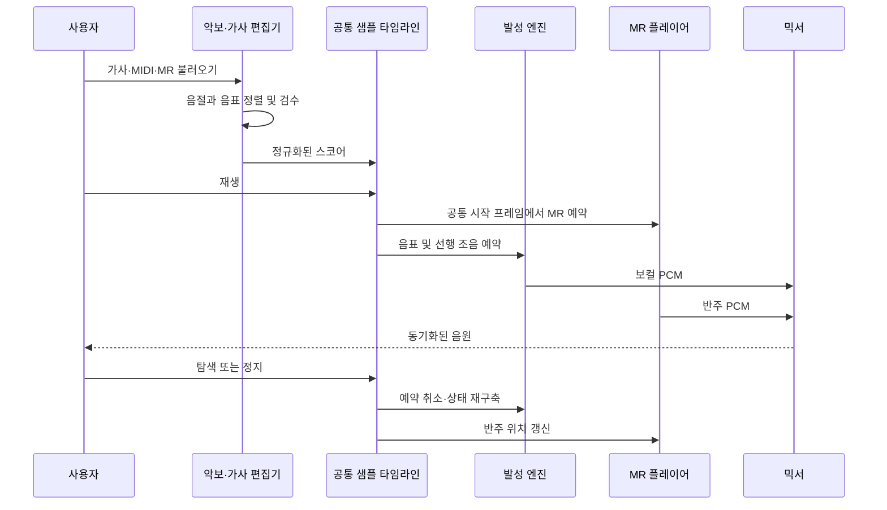

## 7. Voice Homage 데이터 및 권한

[상세 설계](VOICE_HOMAGE.md)

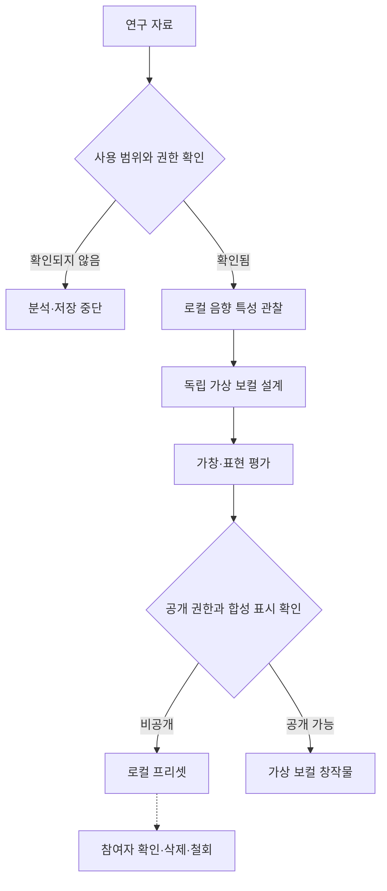

## 8. 가상 악기의 물리 원리

[상세 설계](VIRTUAL_INSTRUMENTS.md)

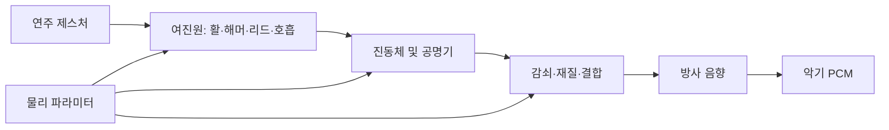

## 9. IRIS 가상 오케스트라

[상세 설계](VIRTUAL_INSTRUMENTS.md)

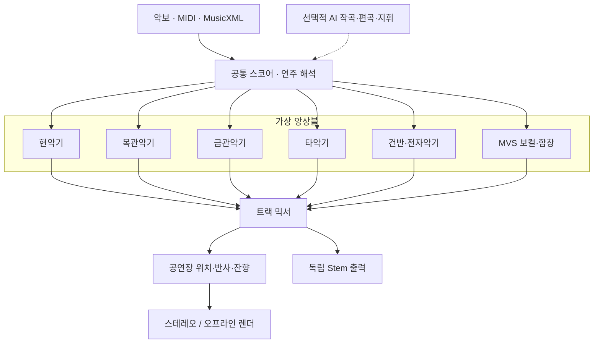

## 10. 스레드 및 렌더 경계

[상세 설계](ARCHITECTURE.md)

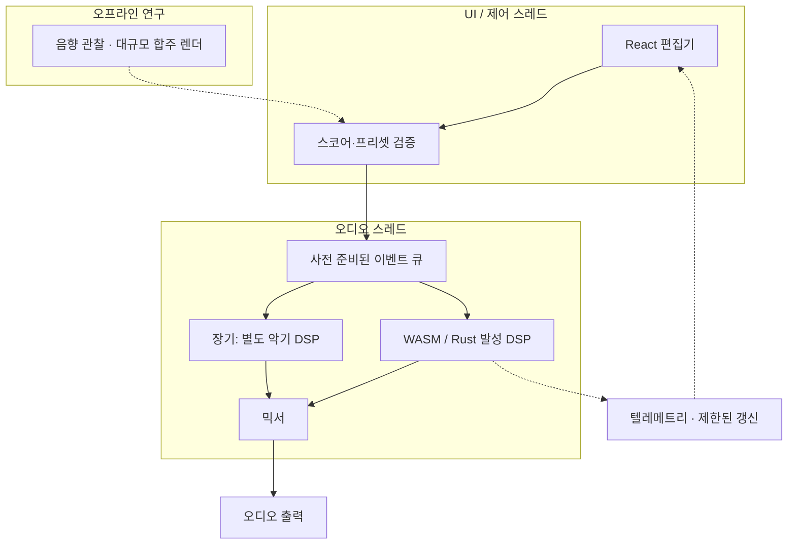

## 11. 연구 로드맵

[상세 설계](ROADMAP.md)

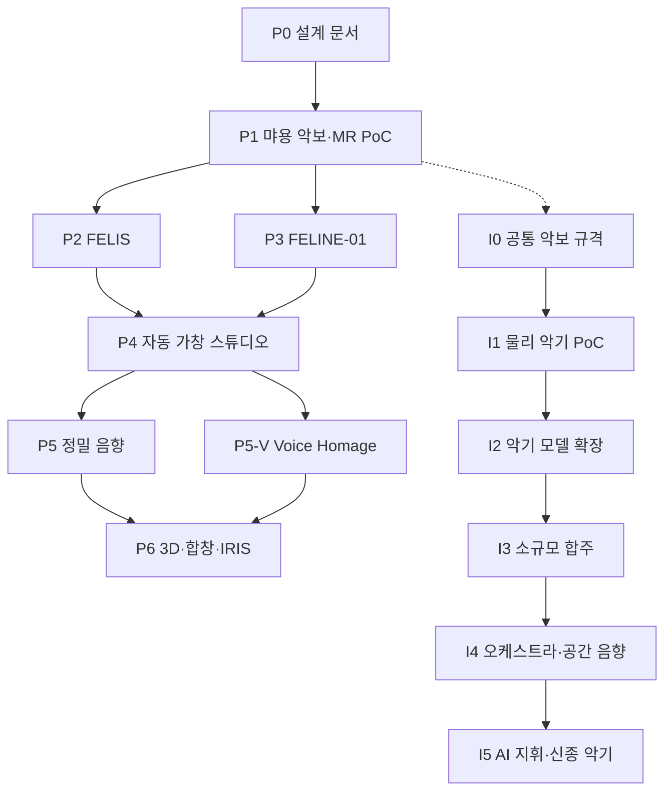

## 12. 포크 분리 및 출처

[상세 설계](PROVENANCE.md)

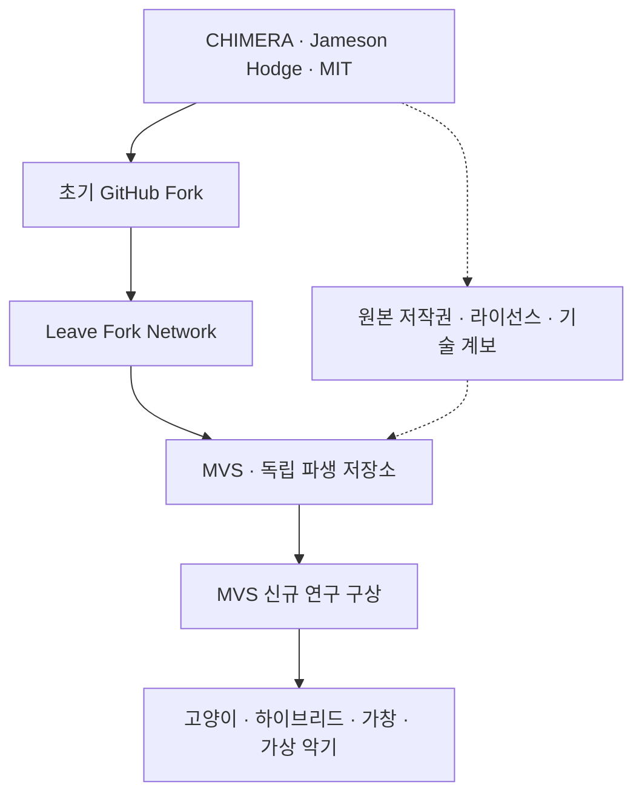

