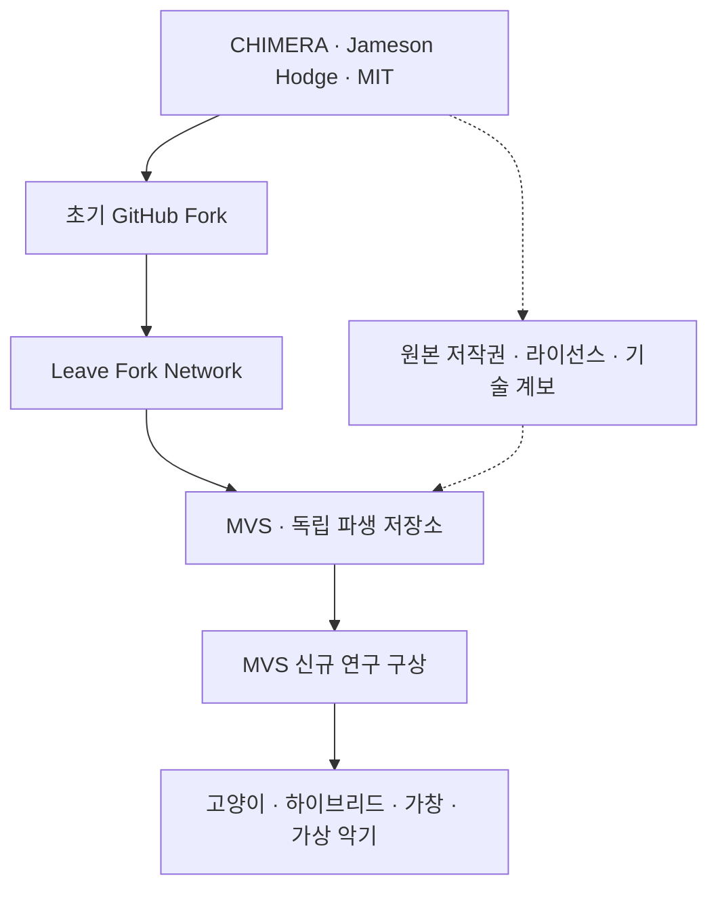

# 출처 및 독립 저장소 안내

MVS (Meow Voice System)는 [Jameson Hodge의 CHIMERA](https://github.com/jamesondh/chimera-vocal-synth)를 기반으로 시작한 파생 연구 프로젝트다.

**GitHub 포크 네트워크에서 분리(Leave fork network)된 독립 저장소**로 운영한다. 저장소 관리자가 설명한 분리 이력과 2026-11-27 확인한 GitHub REST 저장소 메타데이터(fork=false)를 구분하여 기록한다. 현재 GitHub의 포크 관계가 없다는 것은 원본 소스의 출처나 저작권이 사라졌음을 의미하지 않는다. 분리 작업의 정확한 시각은 확인하지 않았다.

- 원본 프로젝트: CHIMERA Vocal Synth
- 원본 저작권 표기: Copyright (c) 2026 Jameson Hodge
- 원본 라이선스: MIT ([LICENSE](../../LICENSE))
- 원본 저장소: https://github.com/jamesondh/chimera-vocal-synth
- MVS 저장소: https://github.com/hslcrb/meow-voice-system

CHIMERA의 Rust 발성 엔진, WASM, 브라우저 UI, 기존 음향 모델, 관련 문서 등은 원본 기여에 기반한다. 기존 라이선스와 제3자 고지 및 출처를 유지한다. MVS의 [실험용 작업실](STUDIO.md)과 향후 고양이 성대, 목소리 오마주, 가상 악기·오케스트라 연구는 별개이며 이를 원본의 구현 성과로 소개하지 않는다. 반대로 기존 엔진을 MVS가 처음부터 자체 개발했다고 주장하지 않는다.

독립 저장소 운영은 원본 개발자의 공식 승인, 소속, 제휴 또는 지원을 뜻하지 않는다. 원본의 배포 링크와 과거 CI 안내는 CHIMERA를 가리킨다. MVS 자체 릴리스와 기능 구현 여부는 별도로 표시한다. 원본 개발자 및 모든 기여자에게 감사를 표한다.

## 계보 도식

관리자의 분리 이력 설명과 현재 GitHub 메타데이터를 바탕으로 한 계보도. 원본 라이선스와 저작권은 유지한다.
