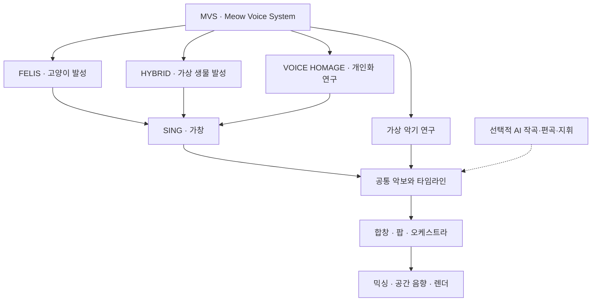

# 먀용 작업실 · MVS 연구 문서 🐈

> 목소리를 흉내 내는 것을 넘어, 목소리가 태어나는 기관을 설계한다.

- 기획일: 2026-11-27 (KST)
- 소속 구상: IRIS / 생체음향 연구
- 상태: **실험용 작업실과 별도 장기 설계**. 현재 실행 계약은 [작업실 사용법](STUDIO.md)을 따른다. 고양이풍·인간풍·혼합은 근사 음색이며, 정밀 성대 시뮬레이션과 완전한 한국어 가창, 개인화 음향 연구, 가상 악기·오케스트라는 연구 범위다.

## 출발점

CHIMERA의 물리 기반 발성 엔진을 보다가 생긴 질문: 고양이의 성대를 시뮬레이션할 수 있다면 인간처럼 말을 하면서 고양이처럼 들리는 가상의 발성기관도 만들 수 있지 않을까? 그리고 가사, 음절별 시각, 음정, 노래방 반주를 합치면 그 가상 생물이 직접 노래할 수 있지 않을까?

첫 실험의 이름은 **먀용**. MVS는 이 질문을 연구 가능한 소프트웨어로 발전시키는 프로젝트다. 단순 피치 시프팅, 고양이 샘플 재생, 실제 가수 목소리 복제를 핵심으로 삼지 않는다. 합성된 공기의 압력, 유량, 성문 개폐 및 공명으로 보컬을 만든다. MR은 외부 입력으로 허용한다.

## 새로운 가창 합성의 지평

MVS는 사람의 발성에서 영감을 얻어 새로운 가상 보컬을 설계하는 Voice Homage 연구도 제안한다. 본인 또는 명시적으로 동의한 참여자의 음향 특성을 연구하고, 물리 발성 모델과 음악 표현 제어를 결합한다. 실존 인물의 정체성을 가장하는 것이 아니라 독립적 창작과 음악 기술 연구를 목표로 한다.

## 음악이 태어나는 가상 세계

발성기관에서 출발한 물리 모델링 연구를 현악·관악·건반·타악·전자악기로 확장하는 장기 구상을 제안한다. 악보와 연주 제어를 음원 계산에서 분리하고, 선택적 AI 작곡·편곡·지휘와 MVS 보컬을 결합해 팝부터 오케스트라까지 연구한다. [Virtual Instruments](VIRTUAL_INSTRUMENTS.md).

## 한눈에 보는 MVS 연구 구조

기획 전체의 개념도이며 현재 구현된 기능을 뜻하지 않는다.

## 문서 지도

| 문서 | 내용 |
|---|---|
| [작업실 사용법](STUDIO.md) | 지금 실행 가능한 한국어 UI·가사/음정 JSON·WAV 명령 |
| [원본 엔진 안내](CHIMERA.md) | 기존 기술 자료와 출처의 한국어 길잡이 |
| [전체 도식](DIAGRAMS.md) | 전체 연구 도식 아틀라스 |
| [제품 비전](VISION.md) | 제품 목표, 기능 범위, 확장 구상 |
| [생체음향](BIOACOUSTICS.md) · [고양이 발성의 연구 근거](FELINE_EVIDENCE.md) | 고양이, 인간, 하이브리드 발성 물리 및 실험과 근거의 구분 |
| [목소리 오마주](VOICE_HOMAGE.md) | 인간 음성의 음향적 오마주, 개인화 연구 및 가상 보컬의 창작 |
| [가창 설계](SINGING.md) · [가사 제공처 비교](LYRICS_PROVIDERS.md) | 가사·시간·음정·MR, 자동 가창 및 데이터 계약, 제공처 검증 범위 |
| [가상 악기](VIRTUAL_INSTRUMENTS.md) | 가상 악기, 팝 밴드, 오케스트라 및 공간 음향 |
| [계보 및 권리](PROVENANCE.md) | 포크 네트워크 분리, 원본 저작권과 독립 연구 계보 |
| [시스템 구조](ARCHITECTURE.md) | Rust/WASM, 코드 연결 지점, 실시간 처리, UI |
| [로드맵](ROADMAP.md) | 개발 순서, 검증, 운영, 위험 및 결정 사항 |

## 계보

원본: [jamesondh/chimera-vocal-synth](https://github.com/jamesondh/chimera-vocal-synth) (MIT). MVS는 GitHub 포크 네트워크에서 분리된 독립 파생 저장소다. [출처와 분리 이력](PROVENANCE.md)을 명시한다. 기존 [LICENSE](../../LICENSE), 제3자 라이선스 및 원본 문서를 보존한다. [기존 음향 설계](../architecture.md), [Rust 엔진 계약](../rust-engine.md), [언어 프런트엔드](../language-front-ends.md), [3D 리그](../rig.md)는 MVS의 기술 기반이다. 이름 변경은 신규 기능 구현을 의미하지 않는다.

MVS의 재미는 가상의 생물을 만들고, 그 생물에게 목소리를 주고, 마침내 음악을 주는 데 있다.

[실험판 개발·검증 기록](DEVLOG.md) · [데스크톱 스틸](assets/studio-desktop.webp) · [모바일 스틸](assets/studio-mobile.webp)
