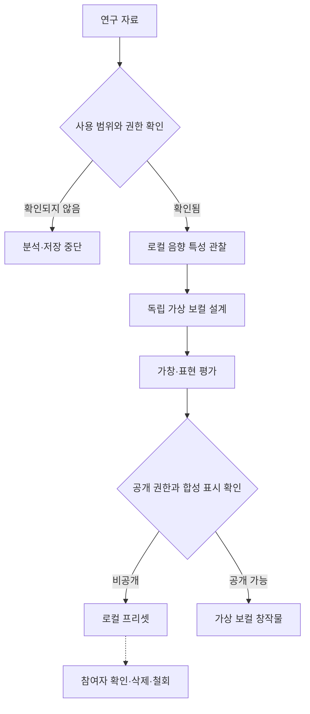

# MVS Voice Homage — 새로운 가상 보컬의 지평

> 인간의 목소리에서 영감을 얻고, 그 영감을 새로운 악기로 발전시킨다.

- 연구 제안: 2026-11-27 (KST)
- 상태: 기획 및 설계. 개인화 분석·최적화·보컬 제작 기능은 미구현.
- 관련: [생체음향](BIOACOUSTICS.md), [가창 엔진](SINGING.md), [아키텍처](ARCHITECTURE.md), [로드맵](ROADMAP.md).

## 1. 연구 동기

사람마다 목소리의 높이, 공명, 호흡, 발음, 강세와 표현 방식이 다르다. MVS는 이러한 다양성을 음성학과 생체음향학의 관점에서 연구하여, 창작자가 자신만의 가상 보컬을 설계하는 음악 제작 환경을 지향한다. 기존 가창 합성 도구에서 음표와 가사를 편집하듯이, MVS에서는 발성 모델과 표현의 특성까지 편집하는 방향을 탐구한다.

본인의 음성을 연구 대상으로 삼거나, 명시적으로 참여에 동의한 보컬리스트와 공동 작업하여 음향적 영감을 얻을 수 있다. 개인화된 음색으로 새로운 악보를 노래하고, 인간의 표현을 바탕으로 고양이풍 등 상상 속 캐릭터의 목소리도 설계할 수 있다. 이는 기존 가창 합성 분야를 확장하려는 연구 목표이며, 기존 상용 제품보다 우수하다는 실험 결과나 특정 제품과의 제휴를 의미하지 않는다.

## 2. 세 가지 연구 모드

| 모드 | 목적 | 결과물 |
|---|---|---|
| Voice Atlas | 다양한 발성 방식의 이해와 교육 | 익명화·집계된 음향 특성 및 비교 그래프 |
| Personal Voice Lab | 본인 또는 동의한 참여자의 음향적 특성 연구 | 로컬 개인화 발성 프리셋과 비교 결과 |
| Voice Homage Studio | 발성 기법과 표현에서 영감을 얻은 독립적 창작 | 가상 보컬, 캐릭터 음색, 가창용 프리셋 |

풍자·극적 낭독·캐릭터 표현도 일반적인 화법(예: 장엄함, 과장된 강세, 리듬, 발성 에너지)으로 설계할 수 있다. 특정 실존 인물의 이름, 소속 또는 정체성을 빌려 그 사람이 실제로 발언한 것처럼 연출하는 기능과 구분한다. 창작물은 독립적인 가상 캐릭터의 표현이며 실제 인물의 발언, 지지, 출연을 의미하지 않는다.

## 3. 연구 방법: 음향 관찰과 물리 모델의 연결

음성 분석에서는 기본주파수 F0의 범위와 변화, 포먼트, 스펙트럼 기울기, 기식음, 강세, 발음 지속시간 등을 관찰할 수 있다. 관찰값은 가상 발성기의 제어 범위를 설계하거나 발성 방식의 차이를 이해하기 위한 참고 자료가 된다.

음성에서 실제 해부학적 구조를 유일하게 복원할 수는 없다. 다른 기관 형상이나 조음 방식도 유사한 소리를 낼 수 있고, 마이크·공간·녹음 상태에 따라 관측 결과도 달라진다. 물리 모델의 역문제는 하나의 가능한 음향적 근사 모델을 추정하는 것이지, 실제 사람의 성대를 스캔하거나 신원을 인증하는 기술이 아니다. 초기 실험은 자체 합성 신호 및 본인의 녹음과 같은 권한 있는 자료로 제한한다.

~~~mermaid
flowchart LR
 A[본인·동의 참여자 또는 합성 시험자료] --> B[로컬 음향 관찰]
 B --> C[발성 특성 요약 및 불확실성]
 C --> D[독립 가상 보컬 설계]
 D --> E[물리 발성 엔진]
 F[가사·악보·표현 제어] --> E
 E --> G[가창·음성 합성]
 G --> H[명료도·음악성·독창성 평가]
 H --> D
~~~

원본 파형을 재생하는 방식이 아니라 기존 CHIMERA의 인간 조음·성문·기도 모델을 활용하는 방향이다. 음향 연구 및 개인화는 오디오 실시간 콜백 바깥에서 수행하고, 가창 시에는 검증된 파라미터 프리셋만 엔진에 전달한다. 음성 분석기나 최적화 알고리즘의 실제 성능은 별도 실험을 통해 확인한다.

## 4. 음악 제작에서의 가능성

- 자신의 음성을 바탕으로 작곡·가창 아이디어를 시험하는 개인 보컬 악기.
- 동의한 보컬리스트와 함께 발성 특성을 설계하는 가상 가수 및 새로운 음색의 창작.
- 원래 목소리와 명확히 구별되는 인간·동물·가상 생물의 보컬 팔레트.
- 발음과 음정뿐 아니라 호흡, 음색, 강세, 비브라토를 독립적으로 편집하는 표현 연구.
- 동일 악보를 서로 다른 발성 모델로 렌더하고 음악적 효과를 비교하는 교육용 도구.
- 자신의 녹음 없이도 제공되는 합성 기본 프리셋으로 누구나 참여 가능한 창작 환경.

악기라는 관점에서 보컬의 고유한 정체성과 표현력을 설계한다. 단일 인물의 정체성을 재현하는 것을 성공 기준으로 삼지 않는다. 가창 음정·가사·반주 동기화 계약은 [SINGING.md](SINGING.md)를 따른다.

## 5. 공개성과 참여자 권리

프로젝트의 목적은 실제 기능과 일치하도록 공개한다. 음성을 분석하거나 개인화하는 기능 자체를 숨기지 않는다.

- 본인의 자료 또는 해당 목적·범위에 명시적으로 동의한 참여자의 자료를 사용한다. 공개적으로 들을 수 있다는 사실은 이용 동의로 간주하지 않는다.
- 개인화 프리셋은 기본 비공개·로컬 저장이며 원본 녹음, 개인별 음향 정보, 프리셋은 공개 저장소에 포함하지 않는다. 다른 사용 목적, 공개 배포, 재사용은 별도의 권한 확인을 거친다.
- 참여자는 자료와 프리셋을 확인·삭제하고 향후 사용 동의를 철회할 수 있어야 한다. 이미 제3자에게 전달된 복제본까지 완전히 회수할 수 있다고 보장하지 않는다.
- 공개 합성 음원에는 가상 보컬/합성 음성 표시와 적절한 출처를 제공한다. 참여자의 이름이나 정체성을 공개할 때는 별도의 동의를 얻는다.
- 사칭, 인증 우회, 허위 발언 증거 제작, 비동의 개인 음성 모방 또는 오인 유도를 기능 목표로 삼지 않는다. 합성 표시만으로 모든 사용이 정당해지는 것은 아니다.
- 음악 작품의 가사·악보·MR·녹음물과 참여자의 음성 사용 권한은 별도로 관리한다.

### 개인화 연구의 데이터 흐름

참여자 권리와 공개 범위를 연구 과정에 포함하는 제안이다. 현재 기능 구현을 뜻하지 않는다.

## 6. 검증 및 단계적 연구

1. 기존 엔진으로 직접 생성한 시험 음원을 분석하여 관측 지표의 안정성을 확인한다.
2. 본인의 권한 있는 녹음으로 발성 특성의 관찰 가능성과 녹음 환경 차이를 평가한다.
3. 독립 가상 보컬 프리셋을 설계하고 기존 가창 엔진으로 자체 제작 테스트 악보를 렌더한다.
4. 음정 정확도, 발음 명료도, 표현 제어의 연속성, 재현성, 음악성을 평가한다. 청취 평가에는 가상 캐릭터의 독창성과 오인 가능성도 포함한다.
5. 동의 범위·공개 설정·삭제 및 합성 표시가 실제 작동하는지 확인한 뒤 참여 범위를 확대한다.

특정 개인과의 동일성이나 생물학적 복원 정확도를 보장하지 않는다. 미측정 결과는 연구 가설로 기록한다.

## 7. 장기 비전

MVS가 지향하는 것은 인간의 표현에서 배우되 그 표현을 새로운 목소리로 발전시키는 물리 모델링 기반의 가창 합성 연구다. 목소리를 고정된 샘플이 아니라 설계 가능하고 연주 가능한 악기로 바라본다. 창작자의 표현 가능성과 음성 제공자의 권리를 함께 존중하는 것이 그 새로운 지평의 전제다.
